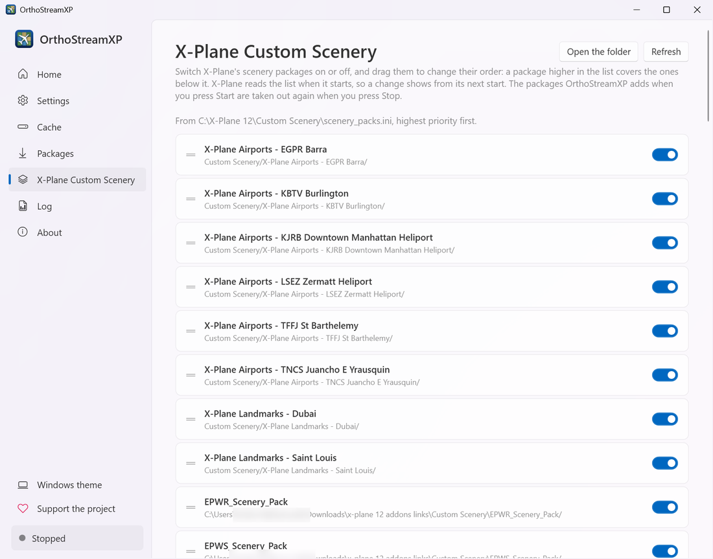
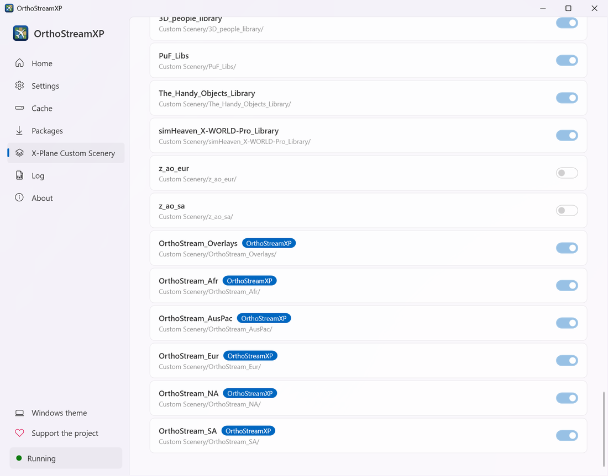

# X-Plane Custom Scenery

[User guide](README.md) › X-Plane Custom Scenery

X-Plane keeps a list of its scenery packages in `Custom Scenery\scenery_packs.ini`. A package higher in the list covers the ones below it: an airport above the photo scenery is drawn on top of the photos. The **X-Plane Custom Scenery** page in the sidebar shows this list, so you can change it without editing the file by hand.

## The list

- The packages are listed in the file's order, **highest priority first**; the line above the list names the file. Under each name is its folder.
- While OrthoStreamXP runs, the packages it shows to X-Plane are marked **OrthoStreamXP**.
- The page needs the **X-Plane folder** to be set in [Settings › Folders](settings.md#folders); until then it says *Choose your X-Plane folder first*. If X-Plane has never started with this folder, the list is empty: X-Plane writes the file the first time it starts.
- **Open the folder** opens X-Plane's `Custom Scenery` folder in Explorer. **Refresh** reads the file again, for example after you installed scenery while the page was open.

## Switching packages on or off

The switch at the end of each row turns a package on or off in X-Plane. A package switched off stays in its folder and in the list; X-Plane just does not load it. This is the same as X-Plane's own `SCENERY_PACK_DISABLED` lines in the file.

## Changing the order

Drag a package by the handle at the start of its row and drop it where you want it: the other rows move apart to show where it lands. Higher in the list means drawn on top.

Leave the photo scenery near the end, below airports and overlays. With **Keep the photo scenery below airports and overlays** on (see [Settings › Other](settings.md#other)), OrthoStreamXP moves its packages back to the end at every start anyway.

## When changes apply

- The list can be changed **only while OrthoStreamXP is stopped**: starting and stopping change the file too. While it runs, the page says *OrthoStreamXP is running: stop it to change the list.* It shows the list as it is, with the switches greyed out and no drag handles.
- X-Plane reads the list when it starts, so a change shows from **X-Plane's next start**.
- Every change is written straight into `scenery_packs.ini`. The other lines of the file stay as they are.

## The packages OrthoStreamXP adds

When you click **Start**, OrthoStreamXP adds its packages to the end of the list. When you click **Stop**, it takes out again the ones it added, because their folders are gone from `Custom Scenery` until the next start. A package that was already in the list before the start (for example from an earlier version of OrthoStreamXP) stays where it is.

To leave one of your own scenery packages out of OrthoStreamXP's photo scenery, use its switch under **Scenery packages** on the Home page instead (see [Flying › Leaving a package out](flying.md#leaving-a-package-out)).

Next: [Troubleshooting](troubleshooting.md)
